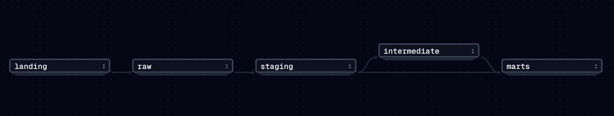
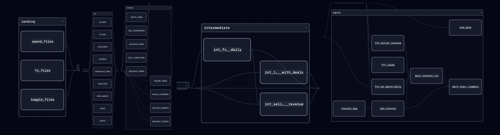

# Marketing ROI Pipeline

[](https://github.com/Jdominguezzz/marketing-roi-pipeline/actions/workflows/ci.yml)


**Which marketing channels bring sellers who actually generate revenue, not just cheap leads?**

An end-to-end ELT pipeline on Olist's public marketplace data: 8,000 leads → 842 won sellers → their orders → CAC and 3-month LTV:CAC by acquisition channel.

## Headline finding

> **Paid social looks 26% cheaper than paid search per lead (€11.5 vs €15.6), but converts at less than half the rate (5.6% vs 12.3%). Each won seller costs 63% more (€207 vs €127) and earns half as much in its first 3 months. On 3-month LTV:CAC, paid search is 3.4× better. Ranking channels by cost per lead points budget the wrong way.**

| Paid channel | Cost per lead | Lead → seller | CAC | 3-month revenue per seller | LTV:CAC (3 mo) |
|---|---|---|---|---|---|
| Paid search | €15.6 | 12.3% | **€127** | €11.92 | **0.094** |
| Paid social | €11.5 | 5.6% | **€207** | €5.77 | **0.028** |

Also from the data: the best-converting leads (16.7%) are the ones with **no tracked channel**, so attribution has to be fixed before budget moves. Full write-up, actions and caveats: **[docs/findings.md](docs/findings.md)**.

> ⚠️ **Ad spend is simulated.** Olist does not publish marketing spend. Spend comes from [config/spend_simulation.yml](config/spend_simulation.yml), calibrated to real lead volume ([ADR-003](docs/decisions/003-simulated-ad-spend.md)). Cost per lead is therefore an assumption; **the reversal comes from conversion and revenue, which are real.**

## Architecture



| Layer | What happens | Tools |
|---|---|---|
| **Landing** | 4 sources landed as immutable files, partitioned by `ingest_date` | Python |
| **Raw** | Idempotent loads into DuckDB, all columns as received, plus `_source_file` and `_loaded_at` lineage | DuckDB |
| **Staging** | One model per source table: rename, cast, standardise, deduplicate | dbt (views) |
| **Intermediate** | Business joins: lead → deal → seller → revenue, AS-OF FX join | dbt (views) |
| **Marts** | Star schema + `mart_channel_roi` and `mart_channel_summary` | dbt (tables) |
| **Orchestration** | 32 software-defined assets, daily schedule, retries on the API | Dagster |
| **Quality** | 14 Python tests, 70 dbt tests incl. reconciliation, CI on every PR | pytest, dbt, GitHub Actions |

<details>
<summary>Full asset lineage (32 assets)</summary>


</details>

### Sources
| Source | Type | Pattern |
|---|---|---|
| [Olist Marketing Funnel](https://www.kaggle.com/datasets/olistbr/marketing-funnel-olist) | CSV snapshot | Batch load, latest snapshot wins |
| [Olist Brazilian E-Commerce](https://www.kaggle.com/datasets/olistbr/brazilian-ecommerce) | CSV snapshot | Batch load, ~100k orders |
| [Frankfurter API](https://frankfurter.dev) (ECB rates, BRL→EUR) | REST API | Incremental by high-water mark, retries with backoff, response validation |
| Ad spend simulator | Daily JSON files | Incremental; injects a duplicate day, a late file and a renamed field for the tests to catch |

## Data quality: what the contracts found

Before any modelling, every table got a [data contract](docs/data_contracts.md) (grain, keys, ranges, issues). Three findings shaped the design:

1. **Only 45.1% of won sellers ever sold (380 of 842).** CAC divides by all won deals; LTV averages over all of them (non-sellers count as 0). Otherwise acquisition looks 2.2× cheaper than it is (survivorship bias).
2. **Order data really ends on 31 Aug 2018,** not at the max date (Sep has 16 orders, Oct has 4). The observation end is an explicit dbt var.
3. **Right-censoring:** deals are won until Nov 2018, so cohorts are compared over the same **3-month window**, using only deals won by 31 May 2018 (667 of 842).

Each rule is a dbt test: e.g. removing `coalesce(spend, cost)` makes `not_null` on spend fail on 5 rows, and mart spend must reconcile with staging to the cent.

## Quickstart

```bash
git clone https://github.com/Jdominguezzz/marketing-roi-pipeline.git
cd marketing-roi-pipeline
make setup        # uv sync
make ci           # lint + tests + full dbt build on the committed sample (no download needed)
```

With the full data (download both Kaggle datasets into `data/kaggle/`):

```bash
make pipeline     # land → load → dbt build
make dagster      # orchestrator UI on http://127.0.0.1:3000
```

## Project structure
```
src/marketing_pipeline/   extract/ (kaggle_files, fx_api, spend_simulator) · load/ · orchestration.py
transform/                dbt project: models/{staging,intermediate,marts}, tests/, macros/, seeds/
tests/                    pytest unit tests (no network, tmp_path isolation)
config/                   spend simulation assumptions
data/sample/              committed CI sample (real Olist rows, all FKs resolve)
docs/                     data contracts, findings, architecture, ADRs
```

## Design decisions
- [ADR-001](docs/decisions/001-elt-duckdb-dbt.md): ELT on DuckDB + dbt
- [ADR-002](docs/decisions/002-idempotent-raw-loads.md): idempotent raw loads with `CREATE OR REPLACE`
- [ADR-003](docs/decisions/003-simulated-ad-spend.md): simulated ad spend, calibrated to real lead volume
- [ADR-004](docs/decisions/004-dagster-orchestration.md): Dagster software-defined assets

## What I'd do next
- Replace the simulator with a real Meta / Google Ads export: only the extractor changes
- Daily partitions and backfills on the FX and spend assets
- Port to BigQuery by swapping the dbt adapter; make the large facts incremental
- A Streamlit page on `mart_channel_summary`; a Docker image

## Data and licence
Olist data: [CC BY-NC-SA 4.0](https://creativecommons.org/licenses/by-nc-sa/4.0/), credited to Olist. Raw files are not committed; `data/sample/` is a small derived subset for CI. Code: MIT.

---
Built by [João Domingues](https://github.com/Jdominguezzz), MSc Data-Driven Marketing (NOVA IMS).
